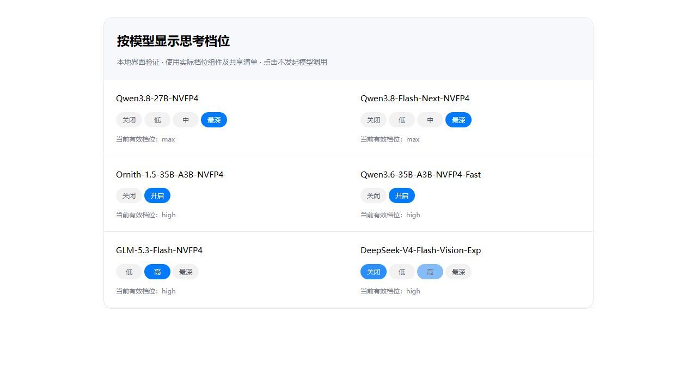

# Reviewed local model thinking controls

Local vLLM and probed SGLang routes use the template facts shipped with the
foundation in `CodeWhale/crates/config/src/local_reasoning.json`. The settings
form, session model picker, runtime bridge and final request shaper read the
same ladder. Provider identity and credential lookup are unchanged.

Frontend development and CI need that pinned public checkout. From the project
root run `git submodule update --init --depth=1 -- CodeWhale` before UI checks;
the private Windows runtime is not required for this metadata dependency.

| Model | Available controls | Request values |
| --- | --- | --- |
| Qwen3.8-27B / Flash-Next | Off, Low, Medium, Max | thinking switch; low, medium, xhigh |
| Ornith-1.5-35B-A3B / Qwen3.6-35B-A3B | Off, On | thinking switch only |
| GLM-5.3-Flash | Low, High, Max | low, high, max |
| DeepSeek-V4-Flash-Vision-Exp | Off, Low, High, Max | prior thinking switch; low, high, max |

Old Qwen3.8 High choices remain saved and display as Max on the vLLM wire;
requests send xhigh in chat_template_kwargs; the top-level effort is omitted
to avoid older server enum restrictions. Old Medium choices for the reviewed GLM/DeepSeek ladders
use High. Boolean templates show On instead of a fictitious depth. A model's
canonical served ID must match a reviewed family; arbitrary aliases/custom
templates are not inferred. Unknown families, cloud routes and the separate
Tachyon/Ollama dialects retain their behavior. The probe continues to decide
the actual wire before display normalization.

These facts establish parameter compatibility, not reasoning quality, latency
or the cause of every service error. The reported Flash-Next Medium and Ornith
failures remain unconfirmed without the original error details. No inference
request, model deployment, service restart or cluster upgrade is part of this
change. Authentication, token budgets, tool permissions, message history,
streaming, request cancellation and retry protections retain their existing
owners.

## Candidate integration

Generic contribution: [upstream #7125](https://github.com/codewhale-hq/Codewhale/pull/7125).
Compatible backport: [Pinvou/CodeWhale #128](https://github.com/Pinvou/CodeWhale/pull/128),
candidate `2ed7b03b5a87559f84172cfb00100efa2b06af7b` on public contributor branch
`Pinvou/CodeWhale:pr128-candidate-rebased` (the contributor fork branch is not writable by
maintainers), based on maintenance `f1eb10efc`.
No protected maintenance branch or release tag was moved. The independent
public-maintenance-head gate remains unchanged and must pass after the backport
is reviewed and landed before this candidate can ship.

## Local preview

Actual tier picker and shared facts, using local fixture state only. No active model calls.

