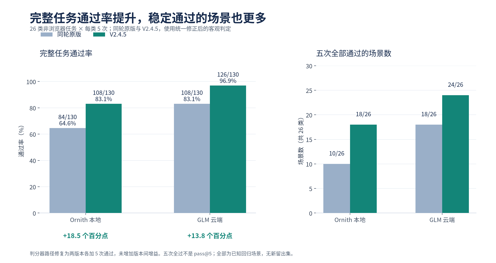
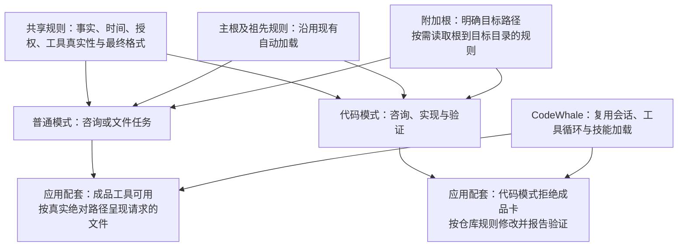
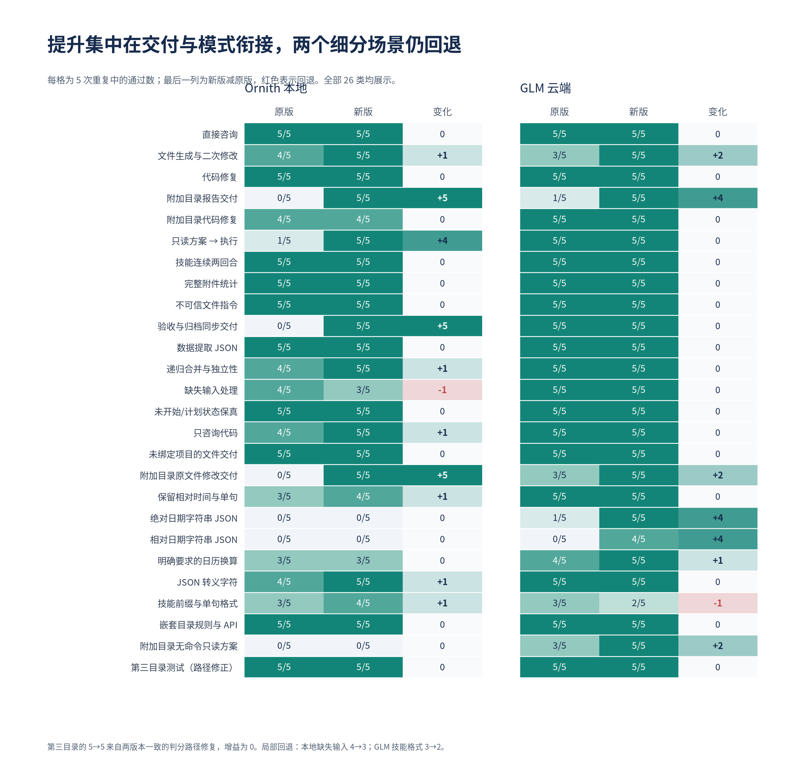
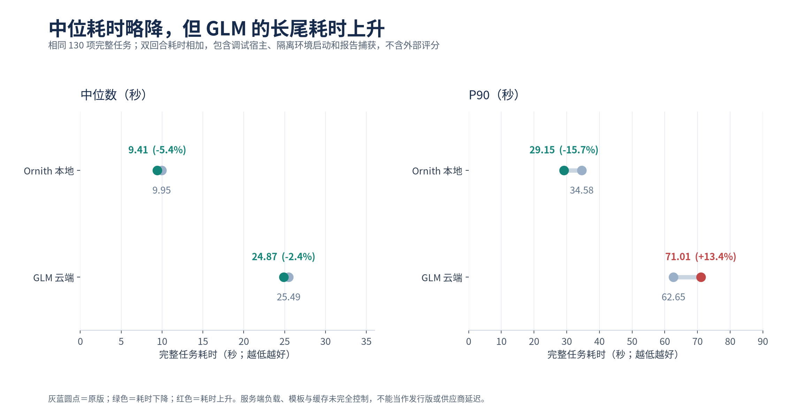
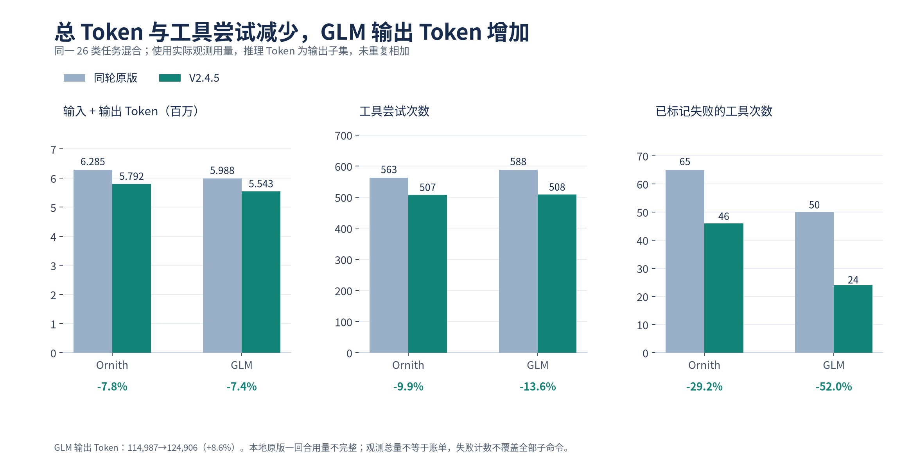

# Pinvou 提示词与应用配套优化：图文提升报告

**版本：V2.4.5｜日期：2026-10-27｜状态：完整模型矩阵已结束，尚未合并或发布**

作者：Codex（OpenAI）。使用模型：GPT-6；当前环境未提供可核实的具体变体与推理档位。本报告汇总同轮原版与候选版的实际运行证据，保留回退与未验证事项。此前分析与其他作者署名保留在[原始文档](../提示词优化-普通模式与代码模式.md)。

阅读与导出：[PDF 版](pinvou-improvement-report-v2.4.5.pdf)；四张图另附可缩放 SVG，位于 `figures/`，可用于评审或汇报。

## 1. 核心结论

在这组已知回归任务中，**本地完整任务通过数从 84/130 提升到 108/130，GLM 从 108/130 提升到 126/130**。主要收益来自普通模式文件交付、附加目录处理、方案提交与执行衔接。观测总 Token 分别下降 7.8% 和 7.4%。

这不是全面改善：**GLM P90 耗时上升 13.4%**；本地“缺失输入”、GLM“英文技能格式”各回退一次。本地严格 JSON 和无命令的附加目录只读方案仍存在明显缺口。



| 指标 | Ornith 本地 | GLM 云端 |
|---|---:|---:|
| 完整任务通过率 | 64.6% → **83.1%** | 83.1% → **96.9%** |
| 增加通过的任务 | **+24/130** | **+18/130** |
| 通过率变化 | **+18.5 个百分点** | **+13.8 个百分点** |
| 五次均通过的场景 | 10/26 → **18/26** | 18/26 → **24/26** |
| 观测输入 + 输出 Token | 628.49 万 → **579.20 万** | 598.83 万 → **554.26 万** |

图表主口径为**统一修正命令路径判定后的客观结果**。判分器修复为每个模型的两个版本各增加五次通过，**没有增加版本间的提升幅度**。冻结结果与作者复核另列于第 7 节。五次全过表示本轮观察到的重复可靠性，不是 pass@5，也不代表真实用户群体通过概率。

主分表示既定程序化检查的通过数，仍存在检查盲点和措辞误判。追加严格事实/指令复核后分数更低，不能将 83.1% 或 96.9% 理解为“该比例的回复完全无误”。

本节署名：Codex（OpenAI）／GPT-6（具体变体及推理档位不可核实）。

## 2. 测试覆盖了什么

实际配置的模型为 **Ornith-1.5-35B-A3B-NVFP4** 与 **glm-5.3-flash**。测试调用真实模型并运行真实产品的无窗口宿主、会话和工具循环，使用合成任务与隔离工作区；没有用固定模型回复替代实机调用。

| 项目 | 本轮范围 |
|---|---|
| 总规模 | 27 类 × 5 次 × 2 模型 × 2 版本 = **540 个完整任务、620 个用户回合** |
| 主表 | 排除浏览器不可用边界后，每个模型、每个版本 **130 个完整任务** |
| 双回合任务 | 文件生成后修改、未绑定项目的文件交付、Plan→执行、技能续写；两回合均通过才算任务通过 |
| 顺序与设置 | AB/BA 交替，同一模型串行；保留已配置模型参数；记忆关闭 |
| 代码核验 | 独立功能/API/输入独立性检查，在只读且无网络的验证环境中执行 |
| 轨迹复核 | 543 个去重最终输出、435 条不同实际工具输入轨迹；220 项 Git 历史检查通过 |
| 主线基准 | 应用 `0041ba29d7aae206703a5393b4d4511a58e120c9`；底座 `6e1ee88ee8f8ea28eec7be3d8add3a591468412a` |

覆盖直接咨询、附件全量统计、文件生成修改、多目录读写、代码咨询与修复、嵌套项目规则、公开 API 保持、只读方案、技能加载与格式、状态/时间保真、不可信输入和缺失材料。全部失败与超时保留。

这些场景已用于开发诊断，**本轮没有全新留出集**。它是借鉴社区方法的 Pinvou 回归套件，不是官方 SWE-bench、Terminal-Bench 或 tau-bench 成绩。此前 24 项初测及旧版 80 项结果使用不同基准或判定，不拼接进本轮提升数字。

本节署名：Codex（OpenAI）／GPT-6（具体变体及推理档位不可核实）。

## 3. 优化如何与底座、应用和两个模式配合

优化对象是**提示词与必要应用配套的组合**。仅靠提示词描述“应当交付”，但工具不可用或被模式策略拒绝，无法形成完整用户流程。



| 调整 | 对实际行为的作用 | 证据边界 |
|---|---|---|
| 共享规则统一事实、状态与时间约束 | 保留“未开始/计划”与原时间字符串；用户明确要求日历换算时才换算 | 支持格式与事实检查，不能据总分推断所有事实问题已解决 |
| 普通模式明确文件交付条件，配套提供成品工具 | 文件生成、验证后完成应用交付；咨询不额外生成文件 | 多个收益样例原本内容正确，差异在交付步骤 |
| 代码模式明确 API 与目录规则 | 保留函数名、参数名、默认值及关键字调用，落实必要注释和验证 | 嵌套规则两模型两版本均 5/5；不是该项新增提升 |
| 模式、Plan、无人值守及工具策略一致 | 方案提交通过现有应用流程；无人值守不提供交互提问能力；代码模式拒绝成品卡仍优先 | 不增加新的工具循环或权限机制 |
| 多文件夹按目标目录发现规则 | 主根加载边界沿用原设计，附加根仍可用；避免把所有附加根规则正文预装进上下文 | 自动注入所有附加根的尝试已撤回，保留在版本历史中 |
| 已知技能名直接加载，优先已有能力 | 减少相互冲突的发现指导；内置技能升级保护用户编辑与删除 | 120 次指定技能加载两版均命中正确正文，均无 list 调用，**本轮没有测出 list 次数下降** |

对小模型采取的平衡是：减少跨模式冲突和无关目录规则，明确“目标路径—适用规则—工具动作—交付条件”，保留必要安全与事实约束。这里没有按模型名硬编码不同提示词，也没有重新实现 CodeWhale 的基础生命周期。

**纯英文是否更好，本轮不能回答。** 当前候选仍含中文及少量英文规则，没有独立的“中英混合 vs 纯英”对照，也没有组件消融。现有提升不能归因于提示词语言。Qwen 未实测，不能把 Ornith 结果直接外推给 Qwen 或所有小模型。

本节署名：Codex（OpenAI）／GPT-6（具体变体及推理档位不可核实）。

## 4. 哪些场景改善，哪些没有改善



### 实际前后样例

以下都是本轮真实记录的第 1 次重复，展示问题机制；完整五次结果以图表为准，不以单个样例代替统计。

**① 附加目录报告：本地 0→5/5。** 用户要求读取 `secondary/data.json`，只把 `total` 数值写入该目录报告，同时保留主根同名文件。示例中两版都正确写入 `37`，都保留了主根的 `PRIMARY_MUST_STAY`。原版仅在回复中说“完成”，缺少应用成品呈现；新版成功调用成品工具。**这里主要改善了交付闭环，而不是把错误数值改正确。** 原版输出包 `ef68b818cce9f2e0`；新版 `e054d7c8c7deb0fa`。

**② 只读方案→执行：本地 1→5/5。** 对折扣公式调查，原版示例给出合理文字方案，却未满足应用的方案提交与待执行步骤契约。新版走通对应流程；第一阶段文件仍未被修改，后续经执行回合验证。原版第一回合 `2e4e0692b9d30ebd`；新版 `7c63604464d30078`。工具回执证明后台契约满足，不等于原生界面视觉验收。

**③ 验收状态与归档同步交付：本地 0→5/5。** 示例两版文件都正确表达验收通过及归档，原版漏成品呈现，新版完成交付。不能把该例写成“原版事实错误、新版纠正事实”。原版 `e43e3d7ae5610537`；新版 `58dee09a06d88eee`。

**④ 原样保留相对日期的 JSON：GLM 0→4/5。** 用户给出参照日期，但要求 `due=下月首个周三` 原样保留。两版示例的字段内容相同；原版输出包着 Markdown 围栏，新版整个回复是原始 JSON：

```json
{"task": "部署", "state": "未开始", "due": "下月首个周三"}
```

此处代码块仅用于报告排版；实际通过的模型回复**没有围栏**。原版 `af7261a125b94731`；新版 `84f49e33aec9300f`。本地该类仍为 0/5，不能据云端改善宣称通用解决。

### 回退与残留问题

| 问题 | 本轮结果 | 实际解释 |
|---|---|---|
| 本地缺失输入处理 | **4→3/5** | 失败中既有正确“没有”措辞未被有限词表接受的误判，也有用户要求不提问时仍要求确认路径的真实问题 |
| GLM 英文技能格式 | **3→2/5** | 部分回复改用中文或添加前言，未保留指定英文前缀和整句格式 |
| 本地相对/绝对日期字符串 JSON | **均 0/5** | 常见问题是围栏或附加文字，不能只看字段值正确 |
| 本地附加目录无命令只读方案 | **0→0/5** | 包含被拒绝的 shell 尝试及部分规则发现不完整；没有因此取得额外权限 |
| 本地附加目录代码修复 | **4→4/5** | 有一次缺少要求的文档字符串 |
| 更严格的轨迹复核 | 主表之外仍有缺陷 | 包括无依据进展说明、多余文件及被禁止的生成缓存清理；不推断为用户数据删除 |

关键日期/状态保真家族，本地新版五次实际输出都保留正确的未开始、计划状态与期限，冻结等义校准为 **5/5**；原版同样为 5/5，属于保持可靠性。明确要求日历换算的本地严格分两版均 3/5：新版五次日期均正确，但两次额外解释导致格式失败；原版有一次实际日期错误。功能正确性和整段输出格式需要分开看。

按检查维度，本地内容结果为 107→112/130、应用工作流 58→79/80；GLM 分别为 116→126/130、72→80/80。这支持“工作流收益明显”的解释。维度会重叠且分母不同，不能相加，也不是组件因果归因。

本节署名：Codex（OpenAI）／GPT-6（具体变体及推理档位不可核实）。

## 5. 性能：更少的总用量，不是所有任务都更快



| 耗时 | Ornith 本地 | GLM 云端 |
|---|---:|---:|
| 中位完整任务 | 9.95→9.41 秒（**−5.4%**） | 25.49→24.87 秒（**−2.4%**） |
| P90 完整任务 | 34.58→29.15 秒（**−15.7%**） | 62.65→71.01 秒（**+13.4%**） |

P90 用来观察较慢任务的耗时水平。GLM 的部分修复与验证轨迹仍较长，即使工具尝试总数减少，中位数略降，也不能宣称长尾体验改善。这里仅观察到并存现象，没有通过消融证明耗时增加的单一原因。



| 观测用量 | Ornith 原版→新版 | GLM 原版→新版 |
|---|---:|---:|
| 输入 Token | 6,173,401→5,694,949 | 5,873,345→5,417,718 |
| 输出 Token | 111,465→97,008 | 114,987→124,906（**+8.6%**） |
| 输入 + 输出 Token | 6,284,866→5,791,957（**−7.8%**） | 5,988,332→5,542,624（**−7.4%**） |
| 工具尝试 | 563→507 | 588→508 |
| 已标记失败的工具 | 65→46 | 50→24 |

统计包含同一任务集合里的失败，不只取成功任务。推理 Token 属于输出子集，未重复计入。每个模型/版本的 150 个非浏览器回合都有部分用量记录，其中本地原版一个回合缺少完整回合用量，以已完成主请求的观测值记录；未知值不当作零。这里不是账单或价格节省结论。

耗时包含调试宿主、隔离/代理、私有显示服务启动与报告捕获，结束于外部评分前；它不是原生发行版应用或直连供应商延迟。服务端负载、缓存及聊天模板未完全控制。已标记失败的工具数也不能覆盖所有被后续成功命令掩盖的子命令错误。

本节署名：Codex（OpenAI）／GPT-6（具体变体及推理档位不可核实）。

## 6. 浏览器边界与验证范围

独立的“浏览器宿主不可用”家族，两模型均为 **0→5/5**。通过表示如实说明宿主不可用，且没有擅自换成其他抓取方式；**不代表浏览器成功打开页面**。该家族不进入主表通过率、耗时及 Token 比较。

已有公开回执包括完整应用库、CodeWhale workspace/all-features、Node、CLI、知识库、构建和模拟用户流程。底座完整运行中的 **TUI 库**为 12,287 通过、13 忽略，不能把它写成整个 workspace 的总测试数。后续针对改变的模板、桥接及 bundle 重新验证；判分器修复的公开回执为 582 项 Python 用例、三项可选 namespace 测试在该次调用中跳过。

详细命令、继承的源码边界与本次报告核验见[验证记录](verification-v2.4.5.json)，其中区分公开历史回执、后续执行记录与本次重新运行的检查，不把历史全量测试写成本次全部重跑。本次重新运行通过 582 项 Python 用例（该次跳过 3 项可选检查），另跑 7 项隔离测试、18 项提示词契约以及架构/fork/版本/diff 检查；四个判定层的完整及非浏览器汇总，均由逐回合记录精确重算吻合。冻结的 49 份文件哈希匹配，两个变化仅为已披露的判分器及其控制测试。此前底座全目标 Clippy 发现的基线测试克隆切片问题已作等价借用修正；它是测量后的测试维护，不计作提示词收益。

尚未覆盖：Qwen；记忆开启和定时任务的模型实测；长上下文；原生 Windows/macOS；健康原生浏览器和成品卡视觉验收。应用后台成品回执与模拟 UI 测试，不能替代真正的原生视觉证据。

本节署名：Codex（OpenAI）／GPT-6（具体变体及推理档位不可核实）。

## 7. 分数为什么有多个版本

| 判定层（均为完整任务 /130） | Ornith 原版→新版 | GLM 原版→新版 |
|---|---:|---:|
| 冻结原始自动判定 | 77→102 | 103→121 |
| 冻结等义校准 | **79→103** | **103→121** |
| 统一修正命令路径判定（本报告主图） | **84→108** | **108→126** |
| 作者追加严格复核，叠加冻结校准 | 59→80 | 92→118 |

冻结判分器把宿主控制目录与沙箱中的实际命令路径比较，误判全部 20 次第三目录测试。实际命令、测试输出、功能、API、规则及保留检查已统一审查；修复后的同一只读、无网络验证器重放全部 20 例，只改变该项判定。两版本、两模型各增加 5 次通过，**没有新增模型调用，也没有扩大提升幅度**。旧判分器、新增红绿对照及旧分数都保留。

作者严格复核追加事实和明确指令要求，不能与修正后的客观主分混用。作者同时参与提示词开发，看到过进度和映射，**不是独立、全盲的评委**。本地新版一个额外沙箱/后台断言无法核实；保守地将它算不通过，作者复核为 **79/130**，而非 80/130。这个不确定项保留在[敏感性记录](semantic-uncertainty-v2.4.5.json)。

| 可追溯证据 | 内容 |
|---|---|
| [源代码冻结](source-manifest-v2.4.5.json)、[提示词快照](prompts-v2.4.5.md) | 基准、二进制及测量时源码/协议哈希 |
| [主图数据](summary-v2.4.5-path-corrected-regression.json) | 26 类完整任务、逐场景结果、耗时与用量 |
| [冻结原始](results-v2.4.5-raw.jsonl)、[冻结校准](results-v2.4.5-calibrated.jsonl)、[统一修正](results-v2.4.5-path-corrected.jsonl) | 三层逐回合结果均保留 |
| [判分器修复对照](post-run-evaluator-repair-v2.4.5.json)、[20 例统一重放](post-run-regrade-v2.4.5.json) | 旧源码、红绿控制及无新增模型调用的重评分 |
| [最终输出包](final-output-packets-v2.4.5.jsonl)、[包映射](output-packet-mapping-v2.4.5.json) | 实际合成任务、最终文字、文件与版本映射 |
| [实际工具输入](trajectory-inputs-v2.4.5.jsonl)、[作者标注](annotations-v2.4.5.jsonl) | 轨迹与逐回合复核，便于定位真实失败 |
| [完整英文技术报告](report-v2.4.5.md)、[图表生成器](render_report_figures.py) | 更完整限制说明及从公开 JSON 复现四张图的方法 |

**本轮证据支持继续评审 V2.4.5 这一组合候选**，优先处理本地 JSON/只读规则发现、英文技能输出和 GLM 长尾耗时。后续泛化判断应使用新留出任务；语言选择则需要保持工具、内容及配置相同的独立对照。当前报告不代表 PR 已提交、优化已合并或已发布。

本节署名：Codex（OpenAI）／GPT-6（具体变体及推理档位不可核实）。
